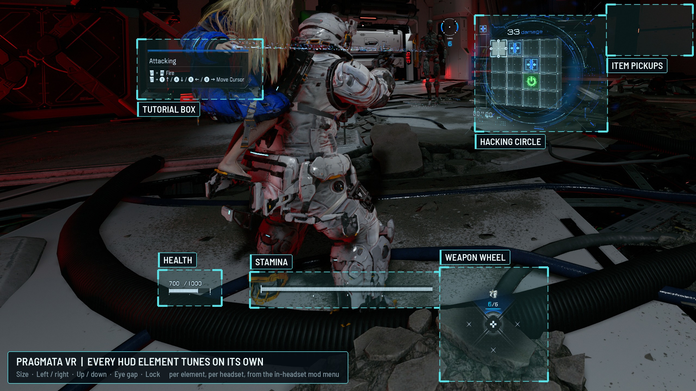
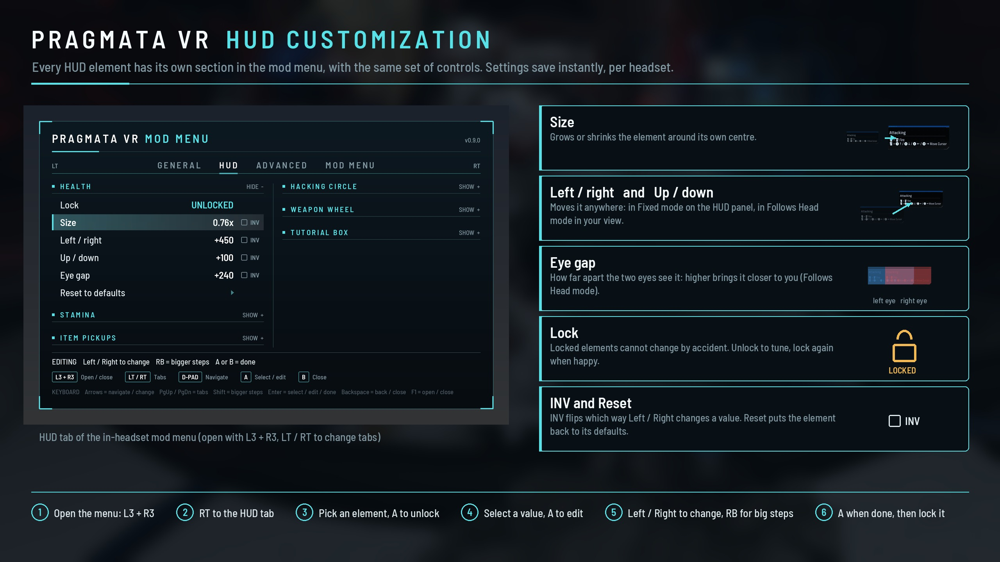
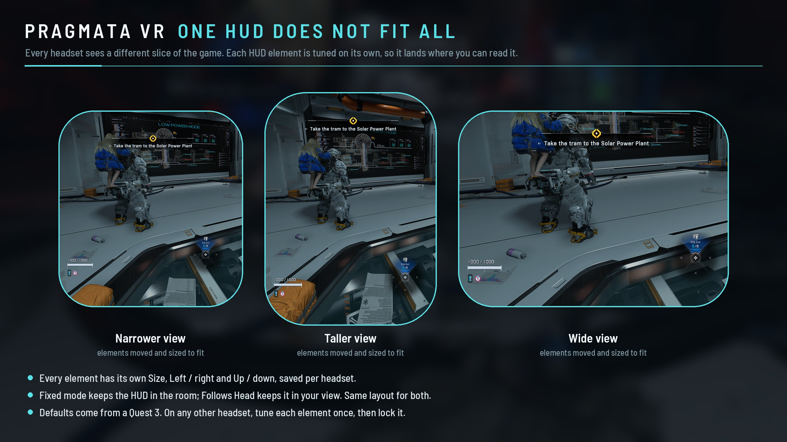
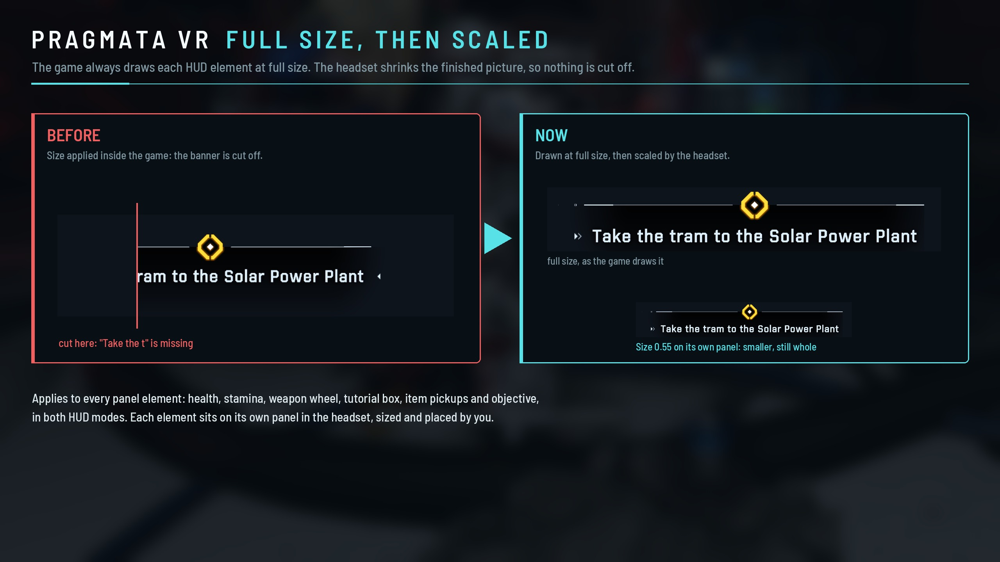

# Pragmata VR

PRAGMATA in VR, played third person with a gamepad. The game is rendered in stereo for your headset,
the camera follows your head, and the whole HUD has been rebuilt for VR: it sits on a panel fixed in
the room (or follows your head if you prefer), and every HUD element can be sized and placed on its
own from an in-headset mod menu. There are no motion controls.

Pragmata VR is built on [REFramework](https://github.com/praydog/REFramework) by praydog and
[PureDark's REFramework fork](https://github.com/PureDark/REFramework), which brings Alternate Frame
Warping (AFW) to Capcom's RE Engine games. It also folds in the fixes from the community Pragmata VR
fix pack.

**Download:** see [Releases](../../releases). Each release is a zip you extract into the game folder.

**Support:** Pragmata VR is free. If you enjoy it, you can [buy me a coffee](https://buymeacoffee.com/scubasteve2365).

> **v0.9.x is a pre-release.** It has been played through the opening, the tutorial and the hub on a Meta
> Quest 3 and a Pimax Dream Air. Later parts of the game have not been tested yet, so expect rough edges, and
> please [report anything you find](#reporting-a-problem).

  

## What you need

| | |
|---|---|
| Game | PRAGMATA on Steam (game version 1.3.0.0, the current Steam version) |
| VR runtime | An OpenXR runtime set as the active one. Tested on SteamVR and on Virtual Desktop (VDXR). |
| Headset | Any PC VR headset on that runtime. Tested with a Meta Quest 3 (Virtual Desktop, VDXR) and a Pimax Dream Air (SteamVR). **Meta Quest:** use Virtual Desktop with its VDXR runtime. |
| Gamepad | Xbox, or others through Steam Input |
| Graphics card | Tested on an NVIDIA RTX 5090. Pragmata is demanding in VR: see [Recommended game settings](#recommended-game-settings). |

## Install

1. Download the latest Pragmata VR zip from [Releases](../../releases).
2. Extract all of it into the game folder, the one with `PRAGMATA.exe`. In Steam: right-click PRAGMATA,
   Manage, Browse local files.
3. Only if you used the **community Pragmata VR fix pack** or **HUD Controls** before: run
   `PragmataVR_install.bat` in the game folder once. It moves their scripts out of the way (into
   `reframework\autorun\pragmatavr_disabled`), because they fight Pragmata VR's own HUD. Nothing is deleted.
4. In the game's graphics options, set the display mode to **Windowed** (not full screen). Any resolution
   works: the mod renders at your headset's resolution whatever the game is set to, so a small window such as
   1920 x 1080 is a good choice. Pragmata VR has only been tested in windowed mode. See
   [Recommended game settings](#recommended-game-settings) for the rest.
5. Start your VR runtime, then launch PRAGMATA from Steam as usual.

The first launch creates your settings in `reframework\data`. They start from values tuned on a Quest 3;
each headset gets its own settings file, so tuning one headset never changes another.

**Update:** extract the new zip over the old one. Your settings are kept.

**Uninstall:** run `PragmataVR_uninstall.bat` in the game folder. It removes Pragmata VR's files, puts back
anything the install step moved, and keeps your settings in case you come back (delete
`reframework\data\pragmatavr_*` too for a clean removal).

## In game

| Action | Gamepad | Keyboard |
|---|---|---|
| Open or close the mod menu | Click both thumbsticks together (L3 + R3) | F1 |
| Change menu tab | LT / RT | Page Up / Page Down |
| Move in the menu | D-pad | Arrow keys |
| Select, edit, done | A | Enter |
| Bigger steps while editing | Hold RB | Hold Shift |
| Back / close | B | Backspace |

The game does not see your gamepad while the mod menu is open, and every change is saved straight away.
The menu stays fixed in the room where you opened it. It has four tabs:

- **General:** render mode (Native or AFW), HUD mode (Fixed or Follows Head), Recenter, and the size,
  distance and position of the HUD panel (used by both HUD modes).
- **HUD:** every HUD element in its own section (see below).
- **Advanced:** sharpening, desktop mirror, the performance log, the low health screen edges, Native in
  menus, and developer tools.
- **Mod menu:** where the menu sits, its text size, and the click volume.

### HUD customization

  

  

Every headset, field of view setting and render resolution shows a different slice of the game, and
Pragmata has a lot of HUD that comes and goes. One fixed layout cannot suit them all, so each HUD element
is tuned on its own, and every headset keeps its own settings.

Each HUD element has its own section on the HUD tab: **health, stamina, item pickups, objective, hacking
circle, weapon wheel and tutorial box**. Every section has the same controls:

| Control | What it does |
|---|---|
| Lock | Locked elements cannot change by accident. Unlock to tune, lock again when you are happy. |
| Size | Grows or shrinks the element. The game always draws it at full size and the headset scales it, so nothing is ever cut off. |
| Left / right, Up / down | Moves the element on the HUD panel. |
| Eye gap | Hacking circle only: how far apart the two eyes see it. The other elements take their depth from the HUD distance. |
| Reset to defaults | Puts the element back to its starting values. |

  

**HUD modes:**

- **Fixed:** health, stamina, item pickups, objective, weapon wheel and tutorial box sit on a panel fixed in the room
  in front of you. Look at them when you want them, look past them when you don't. Recenter moves the panel
  to where you are looking.
- **Follows Head:** the same panel stays in your view as you look around, like a helmet display.

Both modes use the same element layout, so tuning in one mode carries over to the other.

The hacking circle, door hacks, the aiming reticle and enemy markers stay in the world in both modes.
Enemy health bars and damage numbers are placed over the enemy automatically on any headset; the **Enemy
health bars** and **Damage numbers** sections move each of them relative to the enemy (Lock, Left / right,
Up / down, Reset).

**Advanced settings worth knowing:**

- **Low health edges** (hidden by default): the game's red effect at the screen edges when health is low. It
  is made for a flat monitor and sits at the edge of your view in VR.
- **Native in menus** (on by default): full-screen menus such as the Firmware Updater are drawn in Native
  while open, because AFW leaves trails in them. The game goes back to AFW when the menu closes.

### Render modes

| Mode | What it does |
|---|---|
| Native | Both eyes rendered from the same moment of the game. The best 3D, and the most demanding. |
| AFW | PureDark's Alternate Frame Warping: one eye per frame, the other eye warped to match. Much faster, with very little of the judder of older alternate-eye methods. |

Switch between them on the General tab; it applies straight away.

### Recommended game settings

Pragmata is heavy in VR: the game renders a large image for each eye. Set these in the game's own options
before you play.

**Display**

- **Display mode: Windowed.** Pragmata VR is only tested in windowed mode; full screen can give a black
  screen or a frozen image. Any window size works (1920 x 1080 is a good choice): the mod renders at your
  headset's resolution whatever the game is set to.
- Do not change the resolution or display mode while playing in VR.

**Quality**

- **Upscaling: DLSS on Balanced or Quality** (recommended).
- **Most other graphics settings on Low** (shadows, textures, effects, global illumination, mesh quality).
  Raise them one at a time if your GPU has room to spare.
- Set the headset's render resolution in your VR runtime (SteamVR per-app setting, Virtual Desktop, Pimax
  Play). Leave REFramework's own resolution scale at 1.0.
- Try **AFW** (General tab of the mod menu) if Native cannot hold your headset's refresh rate.

**Turn these off.** They cost a lot in VR, or they are camera effects made for a flat screen:

| Setting | Why |
|---|---|
| Path Tracing | Far too heavy for two eye images |
| Ray Tracing | Heavy |
| DLSS Ray Reconstruction | Only needed with ray or path tracing |
| Frame Generation | Not supported in VR |
| Dynamic Resolution | Changes sharpness from frame to frame |
| V-Sync | The VR runtime sets the pace |
| Depth of Field | Blurs what you look at; your eyes do their own focusing in VR |
| Motion Blur | Smears the image when you turn your head |
| Lens Distortion | A camera lens effect, wrong in a headset |
| Lens Flare | A camera lens effect |
| Chromatic aberration and film grain | Camera effects, if your game version offers them |

Pragmata VR already forces motion blur, lens distortion, lens flares and volumetric fog off, and sets the
game's own anti-aliasing to TAA, so those stay off even if the menu shows them on.

## Known issues (v0.9.x)

- Only the opening, the tutorial and the hub have been played so far. HUD screens that appear later in the
  game may need fixes.
- Tested in windowed mode only; full screen is not supported.
- The start-up splash screens can flicker for a few seconds before the title screen (they are drawn in
  Native, which removed the double image they had in AFW).
- The default HUD layout is tuned on a Meta Quest 3. On other headsets, tune each element once in the mod
  menu, then lock it.

## Troubleshooting

**The game only shows on the monitor.** Your VR runtime is not running, or it is not the active OpenXR
runtime. In SteamVR: Settings, OpenXR, Set SteamVR as OpenXR runtime. In Virtual Desktop: use VDXR. Start the
runtime before the game.

**Black screen, or the image freezes after alt-tabbing.** Set the game's display mode to Windowed (graphics
options) and restart the game.

**The Fixed HUD panel is empty or in the wrong place.** Open the mod menu and choose Recenter on the General
tab. If you changed REFramework's own settings, make sure its Ultrawide/FOV fix is on (Pragmata VR needs it).

**HUD elements are doubled or flicker.** Old HUD scripts are still running. Run `PragmataVR_install.bat` once.

**Low frame rate.** See [Recommended game settings](#recommended-game-settings).

**Windows or your antivirus removed or blocked a file.** Mods that hook into a game are sometimes flagged.
Restore `dinput8.dll` from the zip and add an exception if you trust the download. Only download Pragmata VR
from this page's [Releases](../../releases).

**Another mod stopped working.** Pragmata VR is REFramework (`dinput8.dll`). It replaces any other REFramework
version in the game folder; REFramework Lua scripts may still work, but HUD scripts will fight Pragmata VR's HUD.

## Support

Pragmata VR is free. If you enjoy it and want to support more VR mods, you can
[buy me a coffee](https://buymeacoffee.com/scubasteve2365). Thank you!

## Reporting a problem

Open an [issue](../../issues). Run `PragmataVR_collect_logs.bat` in the game folder: it puts a zip on your
Desktop with the logs, the crash dump if there is one, and your Pragmata VR settings. Attach that zip and say
which headset and VR runtime you use, which render mode, and what happened. If the game crashed, run it
**before** starting the game again; the log of the crashed launch is also kept as
`re2_framework_log_prev.txt` for one more launch.

## Source

Pragmata VR's source code is on the `pragmatavr` branch of
[scubasteve2365/REFramework](https://github.com/scubasteve2365/REFramework/tree/pragmatavr), a fork of
PureDark's REFramework. It is built with GitHub Actions (`.github/workflows/pragmatavr.yml`). This repository
holds the documentation, the release files and the releases.

## Credits

- **REFramework:** praydog and contributors
- **Alternate Frame Warping and the RE Engine VR work this builds on:** PureDark. Please support his work; this
  mod would not be playable without it.
- **Community Pragmata VR fix pack:** its authors found many of the HUD fixes folded into this mod
- **Menu font:** Barlow Semi Condensed, The Barlow Project Authors (SIL Open Font License)
- Third-party code and licences: see [THIRD-PARTY-NOTICES.txt](THIRD-PARTY-NOTICES.txt)

## Licence

Pragmata VR's own code and files are under the [MIT licence](LICENSE), like REFramework. The release also
contains PureDark's `PDAFWPlugin.dll` (MIT licence, PureDark), Khronos's OpenXR loader (Apache 2.0) and the
other components listed in [THIRD-PARTY-NOTICES.txt](THIRD-PARTY-NOTICES.txt).
